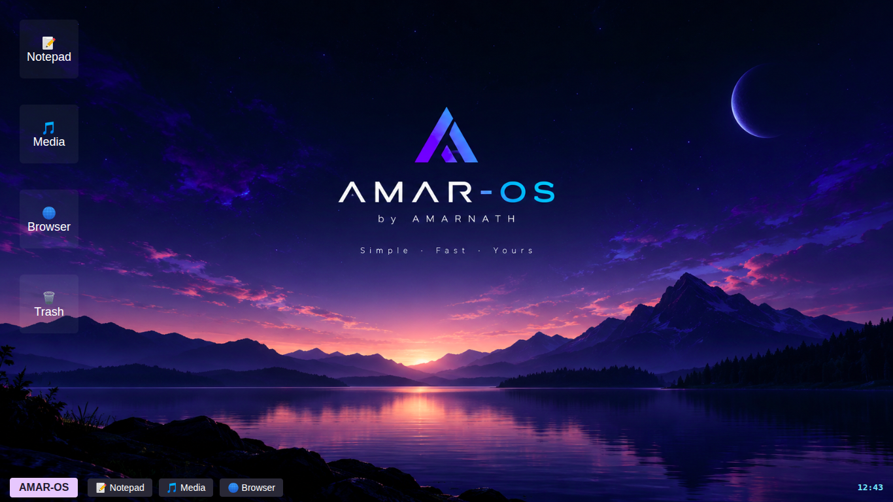
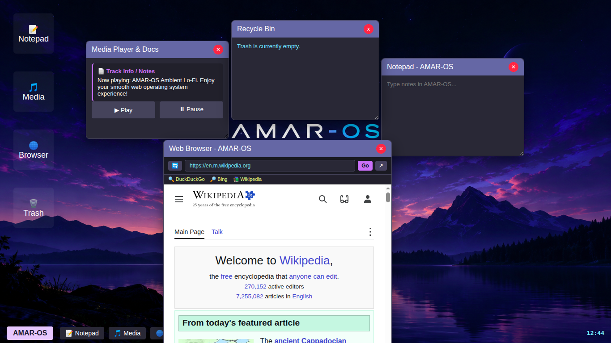
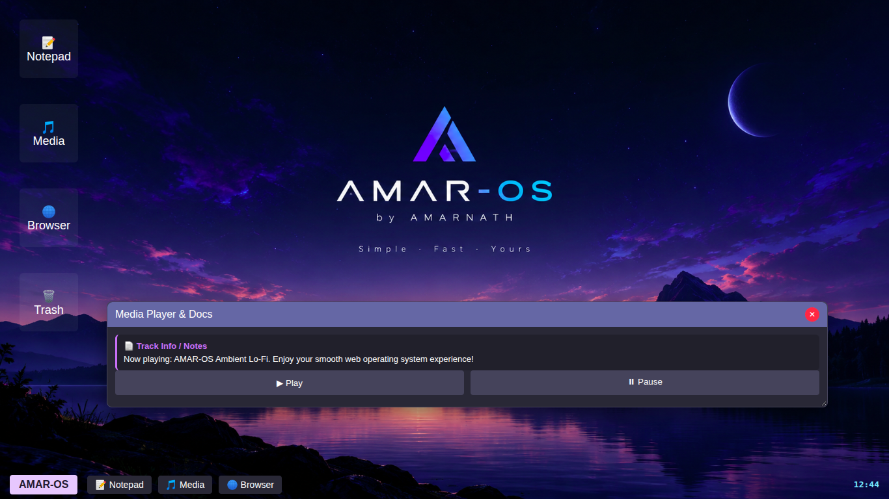
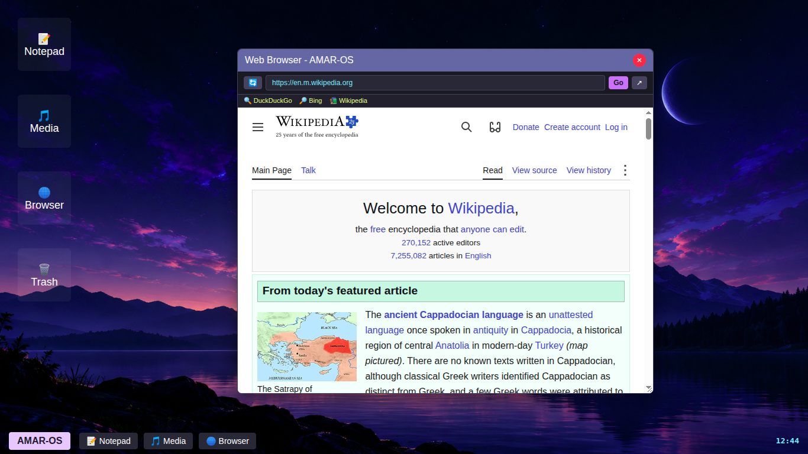
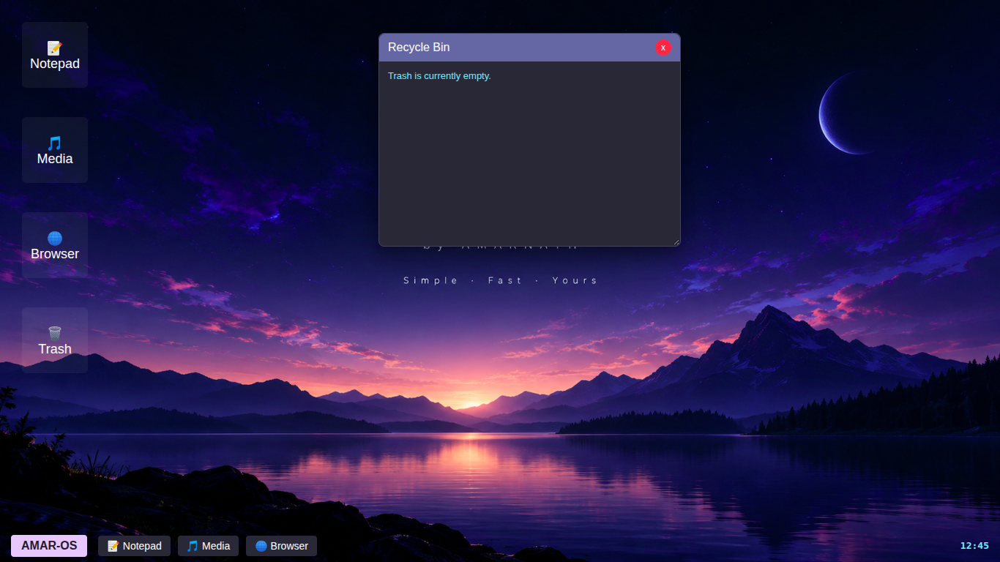
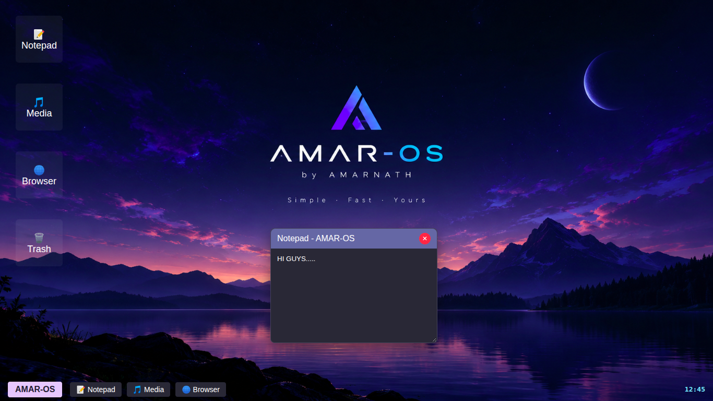

# AMAR-OS
Hey! This is my First Working WEBOS with html,css and some js. Check it out. I hope did you like it.

 Welcome to AMAR-OS my new WebOS . It is a demo premium WebOS , high quality design of a WebOS .

I wanted to build something practical, Premium , and easy to navigate while experimenting with frontend web designing.

# What's Inside?

The project is structured with several connected pages and custom styling:

* index.html : The main OS screen and added some js codes in it.
* style.css : It is the main Styling css document for the index page . It gives colour,style and easy UI experience to the viewers .

If you want to check it out or run it locally on your machine:
1. open and run the "index.html" file in your favourite browser .
2.Explore the AMAR-OS !

Hope, Did you like my OS , checking it out! And your Encouragement is my energy ( Hope @ ).

  ------THANKYOU------
# Screenshots
1. 
2. 
3. 
4. 
5. 
6. 
7. 

